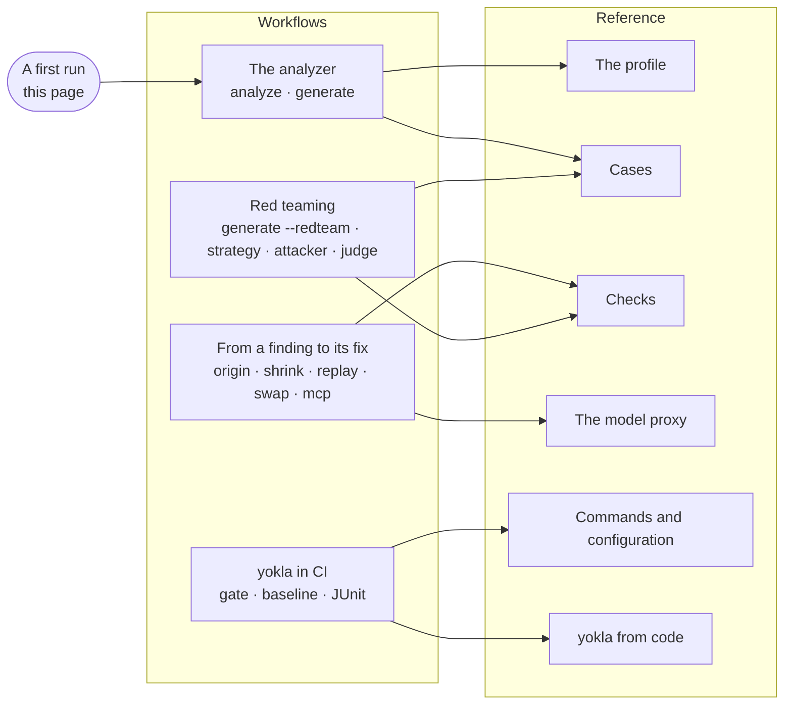

# yokla guide

How to test your own assistant with yokla 0.5. The [design](../design.md)
explains why yokla works this way, and the [ADRs](../adr/README.md) record
each decision.

The commands below run yokla from npm as `npx yokla`. From a checkout of
this repository, `pnpm yokla` runs the same command from source.

## The pages



**Workflows** walk through a task from start to end:

| Page | What it covers |
|---|---|
| [The analyzer](analyzer.md) | From your repository and data to an approved profile, then cases computed from your catalog. |
| [From a finding to its fix](debugging.md) | Where a wrong value came from, the smallest case that still fails, runs that repeat at no model cost, other models, indirect injection, and a coding agent that fixes against your cases. |
| [yokla in CI](ci.md) | The gate, the baseline, budgets and reports in a pipeline: the GitHub Action, and recipes for GitLab CI and Azure Pipelines. |
| [Red teaming](redteam.md) | Attack cases from your profile and data, sent as written, encoded, wrapped or adapted by a model; a calibrated judge for what no rule can decide; findings mapped to frameworks, and the gate. |

**Reference** gives every field and option:

| Page | What it covers |
|---|---|
| [The profile](profile.md) | Reaching the target, reading its answer and evidence, sessions, limits, logs, the model proxy and the e-commerce data. |
| [Cases](cases.md) | Turns, expectations, provider faults, tool result changes and case statuses. |
| [Checks](checks.md) | Every check: what it judges, and when it applies. |
| [The model proxy](model-proxy.md) | Seeing the app's model calls, their cost and prompts, making the provider fail, swapping models and replaying recorded calls. |
| [Commands and configuration](cli.md) | Every command and option, `yokla.config.yaml`, the gate and the baseline, and `yokla mcp` for coding agents. |
| [yokla from code](api.md) | The library API: loading a project, running it, the gate, comparisons and reports, from a program of your own. |

## A first run

With Node.js 24 or later, and your assistant running:

1. **Let `yokla init` write the profile and the starter cases.** Describe the
   request; init works out where the answer is (ADR-0018):

   ```sh
   export ASSISTANT_TOKEN=...      # the profile reads it; a missing one stops the run
   npx yokla init --url http://127.0.0.1:8080/chat \
     --body '{"message": "{{message}}", "session": "{{session}}"}' \
     --header 'authorization: Bearer {{env.ASSISTANT_TOKEN}}'
   ```

   - **What it sends:** one greeting to the target. yokla makes no model call;
     the target may make its own.
   - **What it prints:** where it found the answer and the text it read back.
   - **What it writes:** `yokla.profile.yaml`, `cases/starter.yaml` and the
     `.gitignore` entries. It never overwrites a file without `--force`.
   - **When it can't find the answer:** `--text $.reply` says where it is.
   - **A streamed answer:** pass the header the target streams on, such as
     `--header 'accept: text/event-stream'`.
   - **A target that issues its own session:**
     `--session-url /api/session --header 'x-session-id: {{carry.session}}'`.
   - **Every option:** see [the CLI page](cli.md#yokla-init).

   With the assistant's repository at hand, [`yokla analyze`](analyzer.md)
   proposes much more of the profile: the catalog, the policies, where the
   products are in an answer, and the response contract.

2. **Review, and approve the starter cases.** Read both files: each inferred
   line of the profile says which rule chose it. The starter cases are
   proposed: they run, but don't gate until you set a case's `status` to
   `approved` (ADR-0004). They check what holds for any assistant: a
   non-empty greeting in time, a refused out-of-scope question, an injection
   and a card number not repeated, an empty and a very long message handled,
   and a switch of language when the profile has two.

3. **Run it, then gate it:**

   ```sh
   npx yokla run --profile yokla.profile.yaml --cases cases
   npx yokla gate --results runs/<run id>.json
   ```

   `run` prints a summary and writes the results file. `gate` exits with `0`,
   `1` or `2`, ready for CI ([yokla in CI](ci.md)).

4. **Grow it from there:**
   - **Your own cases:** write the turns and expectations your assistant must
     meet ([cases](cases.md)), and approve nothing you haven't read.
   - **Cases from your data:** `yokla generate` writes lookups, absent types,
     empty price bands and more from your catalog ([the analyzer](analyzer.md#cases-from-your-catalog)).
   - **Product evidence:** map the products your assistant returns as
     evidence. The e-commerce checks then judge its prices, stock claims and
     filters ([profile](profile.md#evidence), [checks](checks.md)).
   - **Model calls:** put the model proxy in front of the app to see its model
     calls and cost ([model proxy](model-proxy.md)).
   - **Baseline:** accept a good run with `yokla baseline`, so a later
     regression breaks the gate ([CLI](cli.md#yokla-baseline)).

[`examples/demo-shop`](../../examples/demo-shop/README.md) is a complete,
runnable example: a small shop assistant with seeded defects, its profile and
its cases.
