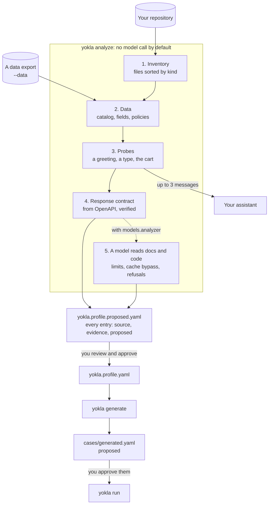

# The analyzer: from your repository to approved cases

A hand-written profile takes an afternoon: where the answer is, where the
products are, which fields hold the price and the stock, where the policies
live. `yokla analyze` proposes it from what your assistant already has: its
repository, its data, and a few messages to it. `yokla generate` then writes
cases whose expectations come from your catalog. Nothing either writes
judges your build until you approve it (ADR-0004).



## Run the analysis

Point it at the repository and the chat endpoint, with the request your
assistant takes:

```sh
npx yokla analyze --dir ../shop-assistant \
  --url http://127.0.0.1:3000/v1/chat \
  --body '{"message": "{{message}}", "sessionId": "{{session}}"}' \
  --language tr
```

- **What it sends:** at most three messages to your assistant, which the
  terminal prints before the first: a greeting, a question for a product
  type from your catalog, and a request to put the first product shown in
  the cart. yokla makes no model call; your assistant may make its own.
- **`--language`:** the language of the probes. Without it, the languages
  of the catalog's names decide, else English. A shop that answers only in
  Turkish answers an English greeting oddly, so name it.
- **A catalog outside the repository,** such as a database export, is given
  with `--data` (ADR-0065). It is read whole, up to 1,000,000 rows, and a
  file cut there is named before anything is sent (ADR-0066):

  ```sh
  npx yokla analyze --dir ../shop-assistant --url http://127.0.0.1:3000/v1/chat \
    --data ./exports/catalog.jsonl --language tr
  ```

**What it finds, in order:**

1. **The inventory.** Each file sorted into a kind: data, contract,
   prompt, doc, env example, manifest, code or other. Secrets, binaries,
   dependency and build folders, and yokla's own files are left out.
2. **The data.** The e-commerce pack proposes the catalog and its fields
   (id, name, type, price, currency, stock), the type separator, the
   languages of its names, and where each policy (returns, shipping,
   warranty) is answered.
3. **The probes.** Where the answer text, the route and the session are,
   and where the products and the cart are in an answer. These are found by
   matching the answer's values to your catalog's, never by guessing from
   key names.
   - A price sent as text, such as `"1999.90"`, is matched as a number and
     proposed with `as: number`.
   - A field one path holds in some products and another in the rest, such
     as a sale price else a list price, is proposed as a fallback,
     `from: [first, second]`, when an answer shows both (ADR-0067).
4. **The response contract.** From an OpenAPI document or a JSON Schema in
   the repository, the schema of your answer, proposed only when every probe
   answer keeps it (ADR-0057).

## Read the summary

```text
proposed 49 entries: yokla.profile.proposed.yaml
  /target/response/text  (probe)
  /target/response/evidence/products/items  (probe)
  /ecommerce/catalog/fields/price  (data)
  ...
undecided: /target/response/evidence/products/fields/price: price.amount, read as a number | price.shown, read as a number; none proposed, pick one
contract: openapi.json POST /v1/chat 200 application/json at $: violated
```

- **Each entry** names its source: `data`, `probe`, `contract`, or with a
  model the kind of file it was read in.
- **`undecided:`** means two paths fit equally well in every product shown,
  so neither is proposed (ADR-0068). You know which one your app means:
  write it into the profile.
- **`contract: … violated`** means your own contract doesn't hold for your
  assistant's answers. The lines under it name each violation by its path
  and keyword. That is a finding about your assistant, not a gap of the
  analysis.
- **`data read to its first … rows`** means a file was cut at the bound, and
  a product the probes show past it can't be matched.

## Review and approve

The proposal holds a `provenance` map at its top
([profile](profile.md#provenance)):

```yaml
provenance:
  /ecommerce/catalog/path:
    source: data
    evidence: "./data/catalog.jsonl: 43 of 43 rows, with id as id, price as price"
    status: proposed
  /target/response/evidence/products/fields/price:
    source: probe
    evidence: "probe 2: price.amount equals the catalog's price in 3 of 3 items"
    status: proposed
```

1. **Read each entry with its evidence.** The evidence says why it was
   proposed: the rows, the probe, the file and line.
2. **Approve it** by setting `status: approved`, or by deleting its line,
   which makes the entry yours. **Reject it** by deleting the entry and its
   line.
3. **Add what it couldn't know:** an undecided field, a header your
   assistant needs, the suites you care about.
4. **Keep the file as `yokla.profile.yaml`.** Until every entry is approved,
   `yokla run`, `explore`, `shrink` and `mcp` refuse it and name what is
   left.

## Compare with a profile you have

With a profile to compare with, the analysis scores itself, entry by entry:

```sh
npx yokla analyze --dir ../shop-assistant --url http://127.0.0.1:3000/v1/chat \
  --profile yokla.profile.yaml --json analysis.json --out proposed.yaml
```

- **Precision** is how many of its proposals are right: same ÷ (same +
  different + new).
- **Recall** is how much of your profile it found: same ÷ (same +
  different + missed).
- A response contract counts leaf by leaf, so a second line gives both
  without it (ADR-0065).
- On the demo-shop it proposes every hand-written entry: precision 100 %,
  recall 71.0 % without a model.

## With a model

A model can also read your docs, prompts and code for three things each
project writes its own way: the rate limits, the cache bypass header and the
canonical refusals (ADR-0049). Configure `models.analyzer` in
`yokla.config.yaml` ([configuration](cli.md#the-configuration-file)), then
estimate before you spend:

```sh
npx yokla analyze --dir ../shop-assistant --url http://127.0.0.1:3000/v1/chat \
  --config yokla.config.yaml --max-cost 0.10 --estimate
```

- **`--estimate` sends nothing.** It prints the files it would send, the
  input tokens, the estimated cost and an upper bound of twice that, and the
  model's url, where your files' text would go.
- **A hosted model receives your code.** A local model keeps it on your
  machine. Data files, environment files and tests are never sent.
- **Every value is checked** against the line it quotes. A value that isn't
  on that line is listed as unverified and never proposed.
- **Files that name what is asked go first** (ADR-0072): a rate limit,
  throttling, `retry-after` or `429`; a cache with `bypass`, `no-cache` or
  `no-store`; a refusal, or any prompt. The shortest of those goes first,
  so no large doc spends the budget alone (ADR-0073). The rest follow:
  docs, prompts, contracts, manifests, env examples, then code, until
  `--max-tokens` (200,000 by default). The estimate says how many marked files the budget
  leaves out; a larger `--max-tokens` reads them, at the cost the estimate
  shows.
- **Replies are cached,** so a rerun on unchanged files costs nothing.

## Cases from your catalog

With an approved profile, `yokla generate` writes cases whose expectations
the e-commerce pack computes from your catalog (ADR-0055). It sends nothing
and calls no model:

```sh
npx yokla generate --profile yokla.profile.yaml \
  --absent tr:hamak --absent en:hammock,kayak
```

| Kind | It asks | It expects |
|---|---|---|
| `lookup` | a product by its name | the product among the answer's |
| `absent-type` | a type you don't sell, from `--absent` | an answer that says so |
| `empty-band` | a type under a price nothing has | no product over it, or an answer that says so |
| `attribute` | a type with an attribute value | that type, with that value |
| `comparison` | which of two products is better | both products shown |
| `refine` | a type, then "and under {amount}?" | that type, under the amount |
| `cheaper` | a product, then something cheaper than it | that type, at most its price, a product shown |
| `unknown-stock` | whether a product of unknown stock is in stock | the product shown; any stock claim about it is a finding |

- **Products in stock, with names of their own.** A named product is in
  stock, and no other product holds its name (ADR-0062, ADR-0063).
- **Every case is proposed,** with the data it came from as its evidence.
  Read it, approve it, then run it.
- **When your catalog changes,** a case whose product, type or price left
  the catalog is `fixture-missing`: it sends nothing, and the run says which
  fact no longer holds (ADR-0053). Update or remove the case.

## Next

- Find what your cases never reach with [`yokla explore`](cli.md#yokla-explore).
- Gate it in your pipeline: [yokla in CI](ci.md).
- Every option: [`yokla analyze`](cli.md#yokla-analyze) and
  [`yokla generate`](cli.md#yokla-generate).
