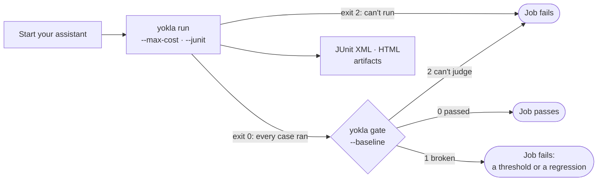

# yokla in CI

yokla is built to decide a build. `yokla run` runs the cases and writes the
results; `yokla gate` judges them against your thresholds and your
baseline, and exits with a code your pipeline understands.



## The exit codes

| Command | `0` | `1` | `2` |
|---|---|---|---|
| `yokla run` | every case ran, whatever the verdicts | | a configuration problem, a token yokla couldn't get, a case in `error`, or a case `fixture-missing` |
| `yokla gate` | the gate passed | the gate is broken: a threshold breached, or a case that passes in the baseline fails now | the run can't be judged: partial, a case in `error`, or a file that can't be read |

`yokla run` leaves the verdicts to `yokla gate`, so a run with failing cases
still exits `0`. Run both, in that order.

## The thresholds

`yokla.config.yaml` sets what breaks the gate, for every suite or per suite
([configuration](cli.md#gate-thresholds)):

```yaml
version: 1
gate:
  maxFailures: 0            # failing cases allowed per suite
  latencyP95Ms: 8000
  suites:
    perf: { latencyP50Ms: 2000, latencyP95Ms: 4000 }
    cost: { costPerTurnUsd: 0.01 }
    resilience: { allowUnmeasured: true }
```

- **Unmeasured is never a pass.** A threshold with no data, such as a cost
  threshold without the model proxy, breaks the gate unless the suite sets
  `allowUnmeasured: true`.
- **Only approved cases gate.** A proposed case runs and reports, but never
  breaks the build (ADR-0004).
- **Attack cases gate too.** `gate.maxRisk` breaks the build on an attack
  kind whose risk score is above it, and `judge.gate` lets the judge's
  dimensions you trust decide their cases ([red teaming](redteam.md#7-gate-on-it)).

## The baseline

A baseline is a run you accepted. With it, the gate also breaks when a case
that passed then fails now, even within `maxFailures`:

```sh
npx yokla baseline --results runs/<run id>.json    # writes yokla.baseline.json
git add yokla.baseline.json
```

- **Small enough to commit.** It holds each case's status and definition
  hash, no answers.
- **A changed case isn't compared:** a case is compared only while its
  definition is unchanged (ADR-0011).
- **`--dry-run`** shows what would change without writing.
- **A known failure** can be marked on its case with `knownGap: { reason,
  issue }`: the case is then `known-gap`, not `fail`, while the bug is
  tracked. Once it passes, the gate notes `gap-closed` and asks for the
  marker to go ([cases](cases.md#the-case)).

## Cost

A suite against a real model costs money on every pipeline run.

- **Estimate it** from an earlier run with the model proxy:
  `yokla plan --cases cases --calibration runs/<run id>.json` prints an
  estimate and an upper bound, and contacts nothing.
- **Cap it:** `yokla run --max-cost <usd>` starts no new sample once the
  model cost reaches the cap, and the run says it stopped.
- **Gate it:** `costUsd` and `costPerTurnUsd` thresholds break the build
  when a change makes the assistant more expensive.

## A GitHub Actions workflow

This example starts the assistant, runs the suite with a cost cap, gates it
against the committed baseline, and keeps the reports. Adapt the start
command and the health url to your assistant.

```yaml
name: assistant
on: [pull_request]

jobs:
  yokla:
    runs-on: ubuntu-latest
    steps:
      - uses: actions/checkout@v4
      - uses: actions/setup-node@v4
        with:
          node-version: 24

      - name: Start the assistant
        run: |
          npm ci
          npm start > assistant.log 2>&1 &
          for i in $(seq 1 60); do
            curl -sf http://127.0.0.1:3000/health && exit 0
            sleep 1
          done
          echo "the assistant did not start"; cat assistant.log; exit 1

      - name: Run the cases
        run: npx yokla@0.5.0 run --out runs/ci.json --junit runs/junit.xml --html runs/report.html --max-cost 1
        env:
          ASSISTANT_TOKEN: ${{ secrets.ASSISTANT_TOKEN }}

      - name: Gate
        run: npx yokla@0.5.0 gate --results runs/ci.json --baseline yokla.baseline.json

      - name: Keep the reports
        if: always()
        uses: actions/upload-artifact@v4
        with:
          name: yokla
          path: runs/
          retention-days: 7
```

- **Pin the version,** as above, so a new yokla release can't change your
  verdicts unannounced.
- **The results and the HTML report hold your assistant's answers.** Keep
  them as short-lived artifacts, not in the repository, when the answers
  may hold personal data.
- **Secrets go through the environment.** The profile reads them with
  `{{env.NAME}}`, and yokla never writes a token into its files.
- **With the model proxy,** start `yokla proxy` before the assistant and
  point the assistant's provider base url at it
  ([the model proxy](model-proxy.md#set-it-up)). The run then measures cost
  and latency per turn, and faults can run.

## Reports

- **The terminal summary** names each case that didn't pass, with its first
  failing finding.
- **JUnit XML** (`--junit`) shows each case as a test in your CI's test view.
  It holds none of the assistant's answers.
- **The HTML report** (`--html`, or `yokla report --html` later) is one
  offline file: every turn with its answer, findings, evidence and model
  calls, the failing cases first.

## Next

- When the gate breaks: [from a finding to its fix](debugging.md).
- Every option: [`run`](cli.md#yokla-run), [`gate`](cli.md#yokla-gate),
  [`baseline`](cli.md#yokla-baseline), [`plan`](cli.md#yokla-plan).
