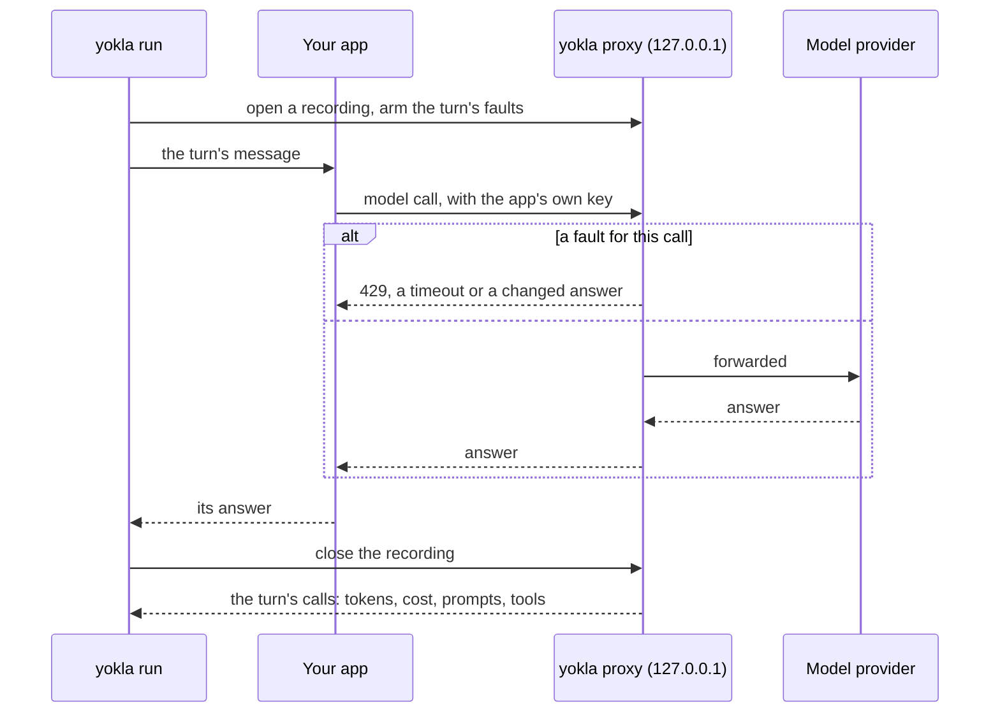

# The model proxy

`yokla proxy` sits between your app and its model provider (ADR-0012). With it,
each turn shows the model calls it caused, their tokens, cost and latency,
and the prompts they sent. yokla can also make the provider fail on purpose
during a turn.



The proxy speaks the OpenAI-compatible APIs (chat completions, the Responses
API, embeddings), the Anthropic Messages API, Gemini's native API on AI
Studio and Vertex AI ([below](#gemini)), and the AI SDK's gateway protocol
([below](#the-ai-sdks-gateway)), as JSON or event streams.
The app must let you set its provider base URL. For a target whose calls the
proxy can't see, read them from the app's OpenTelemetry spans
([below](#model-calls-from-opentelemetry-spans)), or read its logs
(`target.observe.logs` in the [profile](profile.md)).

## Set it up

1. **Declare the upstreams in the profile.**

   ```yaml
   modelProxy:
     port: 8787
     correlation: serial
     upstreams:
       - id: openai
         kind: openai-compatible
         upstream: https://api.openai.com/v1
         appBaseUrlEnv: OPENAI_BASE_URL
       - id: anthropic
         kind: anthropic
         upstream: https://api.anthropic.com
         appBaseUrlEnv: ANTHROPIC_BASE_URL
   ```

2. **Start the proxy** in its own terminal. It prints the local address of
   each upstream and the app setting to point at it:

   ```sh
   pnpm yokla proxy --profile yokla.profile.yaml --records runs/calls.jsonl
   ```

3. **Start the app** with its base URL pointed at the proxy, for example
   `ANTHROPIC_BASE_URL=http://127.0.0.1:8787/anthropic`. The app keeps its own
   API key: the proxy passes the app's headers on and never records them.

4. **Run the cases** as usual. Before any request, `yokla run` checks that the
   proxy answers and routes every upstream the profile declares. Otherwise it
   stops with exit code `2`. The run opens a recording on the proxy, and
   closes it at the end, even when the run fails.

Outside a recording the proxy only forwards; it records nothing.

### Gemini

An app on Google's SDKs calls Gemini's native API. An upstream of kind
`gemini` reads it, on AI Studio and on Vertex AI alike (ADR-0032):

```yaml
modelProxy:
  upstreams:
    - id: gemini
      kind: gemini
      upstream: https://generativelanguage.googleapis.com   # or https://aiplatform.googleapis.com
```

- **Point the SDK at the proxy** through its base url option, at
  `http://127.0.0.1:8787/gemini`. The app keeps its key or token: an
  `x-goog-api-key` header, a `key` query parameter or an `Authorization`
  bearer token pass through, and the records keep the path without its query.
- **What the proxy reads.**
  - `generateContent`, and `streamGenerateContent` as server-sent events
    (`alt=sse`) or a JSON array.
  - The model: `modelVersion`, or else the one in the url.
  - The prompts: `systemInstruction` and `contents`, with a `functionResponse`
    as a tool message that names its tool.
  - The tools a call offers (`functionDeclarations`), and the `functionCall`
    parts an answer asks for.
- **How it counts tokens,** from `usageMetadata`:
  - input is `promptTokenCount` plus `toolUsePromptTokenCount`;
  - cached input is `cachedContentTokenCount`;
  - output is `candidatesTokenCount` plus `thoughtsTokenCount`, since
    thinking is billed as output, and reasoning shows the thinking apart;
  - a cache write isn't reported, so it is null.
- **Other calls,** such as `countTokens` or embeddings, are recorded with
  their usage unmeasured.
- **Faults** take Gemini's shapes, such as its error body with
  `RESOURCE_EXHAUSTED`.
- **An app on Gemini's OpenAI-compatible endpoint** needs no `gemini` upstream:
  `openai-compatible` reads it.

### The AI SDK's gateway

An app on the Vercel AI SDK's gateway provider speaks the SDK's own
protocol to the gateway. An upstream of kind `ai-gateway` reads it
(ADR-0069):

```yaml
modelProxy:
  upstreams:
    - id: gateway
      kind: ai-gateway
      upstream: https://ai-gateway.vercel.sh/v4/ai
```

- **Point the provider at the proxy** through its `baseURL` option, at
  `http://127.0.0.1:8787/gateway`. An app that builds its provider without
  one can't be pointed anywhere: give it that setting first. Its key and
  the gateway's own headers pass through, never recorded.
- **What the proxy reads,** from `POST …/language-model` calls of
  specification version 4:
  - the model from the `ai-language-model-id` header, or the answer's
    model when it names one; streaming from `ai-language-model-streaming`;
  - the prompts: `system`, `user`, `assistant` and `tool` messages, a
    `tool-result` part as a tool message that names its tool;
  - the tools a call offers, and the `tool-call` parts an answer asks for;
  - the answer's text: its `text` parts, or a stream's `text-delta`s.
- **How it counts tokens,** from `usage`: input is its total input, with
  cache reads and writes within it; output is its total output, with
  reasoning apart. A count it leaves out is null.
- **Other calls,** such as `/config`, embeddings, or a call of another
  specification version, are forwarded and recorded with nothing read.
- **What it changes:** a fault takes the gateway's error shape; a model
  swap rewrites the model header; a tool result change applies to a
  `text` output as text, and to a `json` output only by a path.

## Tie calls to turns

| `correlation` | How | Use it when |
|---|---|---|
| `serial` (default) | yokla sends one request at a time and marks each turn on the proxy. A call belongs to the turn in flight when it started. | The app can't pass a header on to its provider calls. Needs `--concurrency 1`. |
| `header` | yokla sends `x-yokla-trace` with every request, and the app forwards it to its provider calls. | The app can forward the header. Works in parallel runs. |

A call tied to no turn is counted as unattributed, never dropped. A call that
a `session.open` request causes stays unattributed in serial mode.

### Calls after the answer

Many apps call their model after they answer, for example to update a memory
or a summary. In serial mode yokla waits after each answer until the target
goes quiet: no call in flight, and none for `modelProxy.settle.quietMs`
(default 250). Such a call then counts for the turn that caused it. Every
recording also settles before it closes, so the last turn's calls are kept.
A target that never goes quiet within `maxWaitMs` (default 10000) leaves an
issue on the turn, and the run goes on.

## Model calls from OpenTelemetry spans

Some apps can't point their model client at the proxy: an SDK with a fixed
endpoint, a managed agent service, or a call from a process yokla doesn't
start. If the app describes its model calls as OpenTelemetry spans, by the
GenAI conventions, the proxy can read them instead (ADR-0029).

1. **Turn spans on in the profile.** `upstreams` may be empty when spans are
   the only view of the calls:

   ```yaml
   modelProxy:
     port: 8787
     upstreams: []
     spans: { quietMs: 6000, maxWaitMs: 20000 }
   ```

2. **Point the app's exporter at the proxy,** over OTLP/HTTP, as JSON or
   protobuf, gzipped or not:

   ```sh
   OTEL_EXPORTER_OTLP_TRACES_ENDPOINT=http://127.0.0.1:8787/_yokla/otlp/v1/traces
   ```

   gRPC export isn't read yet.

3. **Let the trace context through.** yokla sends each turn a W3C
   `traceparent` header with a trace of its own. The app must carry it on to
   its model calls, as OpenTelemetry's HTTP server instrumentation does. A
   span belongs to the turn whose trace it is in. A span from any other trace
   is counted as unattributed, never guessed by time.

What yokla reads from a span:

- **Only spans with `gen_ai.operation.name`** are model calls.
- **The provider** is `gen_ai.provider.name`, else `gen_ai.system`.
- **The model** is `gen_ai.response.model`, else `gen_ai.request.model`.
- **Token counts** come from `gen_ai.usage.*`, under both the current and the
  older names. A count the span doesn't give is null, never 0.
- **The duration** is the span's start to end. A span with an `ERROR` status
  or an `error.type` failed.
- **Message contents are never read,** in attributes or in events.

**Waiting for spans.** Exporters send spans in batches, every five seconds by
default. At its end, the run waits until no span has come for
`spans.quietMs` (6000 ms by default), or until `spans.maxWaitMs` (20000 ms)
runs out, and says when it ran out. An app that exports sooner, for example
with `OTEL_BSP_SCHEDULE_DELAY=500`, lets you lower `quietMs`.

**What you get.**

- **Each turn keeps the calls of its spans,** as `spans` next to `proxy`, each
  with its provider, model, duration, tokens and cost. The run keeps a summary.
- **A turn the proxy saw no calls for is judged on its spans.** `cost-budget`
  and the token limit of `prompt-budget` then apply.
- **Prompt inspection and tool calls still need the proxy:** spans carry no
  prompts or tool calls here.
- **Without upstreams,** the run's correlation is `traceparent`, it allows any
  concurrency, and it refuses provider faults, which only the proxy can
  inject.
- **With upstreams too,** the proxy keeps its own correlation for its calls,
  and each turn shows both views. HTTP targets only: a WebSocket target sends
  its headers once.

The run says so when spans came but none carried a turn's trace: the app may
not pass the incoming `traceparent` on.

## Prices and cost

`yokla.config.yaml` gives prices per upstream id and per model, in USD per
million tokens:

```yaml
version: 1
prices:
  anthropic:
    claude-haiku-5-5: { input: 0.10, output: 0.50, cachedInput: 0.01, cacheWrite: 0.125 }
```

- **The model name is the provider's.** It is the name in the provider's
  answer, or in the request when the answer gives none. A gateway may use its
  own names, such as `anthropic/claude-haiku-5.5`.
- **A span's call is priced by its provider name,** such as
  `prices.openai.<model>`, since a span names no upstream.
- **Cache prices default to the input price,** so cost is never understated.
- **Input tokens include cache reads and writes.** For Anthropic, the
  provider counts them apart, and yokla adds them to the input.
- **Unpriced or unmeasured calls cost null.** That holds for a call whose
  model has no price, or whose tokens the provider didn't report. A turn with
  such a call costs null too; a turn without calls costs 0.

Results carry each turn's calls and cost, and the run's totals. The terminal
summary prints the totals and how many calls had no value for each token kind.

### Reconcile with the provider

To trust the numbers, compare one run with the provider's own usage records:

- **Use a key for the test alone,** so the provider's usage page shows only
  the run.
- **Compare call for call.** Check the call count, then input, cached and
  output tokens, then the cost. The `--records` file holds every recorded
  call, without keys.
- **Mind the time zone.** Usage pages often show UTC.

## Budgets and the cost cap

ADR-0014 covers three ways to keep cost in bounds:

- **Per turn:** `budget: { costUsd, modelCalls }` in a turn's `expect`, judged
  by `cost-budget`.
- **Per suite:** `costPerTurnUsd` and `costUsd` gate thresholds (see the
  [CLI](cli.md#gate-thresholds)).
- **Per run:** `yokla run --max-cost <usd>` starts no new sample once the
  recorded cost reaches the cap. The results are then partial, and the gate
  can't judge them. A call without a cost makes the cap unenforceable, so the
  run stops there too. Without upstreams, the cap counts the costs of spans;
  a span that comes late is counted at the next check.

`yokla plan` estimates a run's cost from an earlier run before you spend
anything:

```sh
pnpm yokla plan --cases cases --calibration runs/<run id>.json --samples 3
```

It prices each case from its own earlier turns when its definition is
unchanged, otherwise from the mean turn. A turn the proxy saw no calls for is
priced by its spans. It prints an upper bound, the
estimate times `plan.upperBoundFactor` (2 by default). Without a usable
calibration, it gives no figure and exits with `2`.

## Provider faults

A turn's `faults` make the provider fail during that turn only: an error
status, latency, a timeout, malformed JSON, empty content, a cut stream or
invalid tool-call arguments. An `answer` fault makes the model say a text of
your choosing instead (ADR-0040). See [cases](cases.md#provider-faults).

## Model swaps

`yokla run --swap-model <upstream>:<asked model>=<model>` tries another
model under the app's own cases, with the app unchanged (ADR-0042). Each
call to that upstream that asks for the model goes to the other instead.

```sh
pnpm yokla run --swap-model openai:gpt-big=gpt-mini --out runs/mini.json
pnpm yokla run --swap-model openai:gpt-big=gateway/vendor/gpt-mini --out runs/gateway.json
```

- **The same protocol only.** The proxy changes the model's name: the
  body's `model`, the `models/{model}` segment of a Gemini path, or a
  gateway call's `ai-language-model-id` header (ADR-0069). A body
  it changes is sent uncompressed, with its new length.
- **`=<upstream>/<model>`** sends the call to another upstream of the same
  kind, when the profile names one by that name; otherwise the whole is the
  model's name, so a gateway's `vendor/model` stays one.
- **Only the model asked for is swapped,** so an app that uses two models
  for two jobs can swap each apart.
- **What the results keep.** Each swapped call keeps the model the app asked
  for as `asked`, and is priced by the model that answered: a model without
  a price costs null. `run.swaps` lists each swap with the calls it changed;
  a swap that changed none is a run issue.
- **Within the run's recording only,** and never with a cassette.
- Compare the runs with [`yokla compare`](cli.md#yokla-compare).

## Tool results changed by the proxy

Within a recording, the proxy can change the tool results a call sends
before the model sees them (ADR-0043). A result is found where the proxy
reads it (ADR-0026) and named by its call's id, in every protocol it speaks.

- **An injection, per turn.** A case turn's `toolResults` append text to a
  tool's results, to test indirect injection; `injection-canary` judges it
  (see [cases](cases.md#tool-results-changed-by-the-proxy)).
- **A metamorphic change, per run.**
  `yokla run --reverse-items 'search_products=$.results'` reverses each
  array the path selects in every result of that tool. Run the cases with
  and without it, then `yokla compare --expect-same` exits with `1` when a
  verdict moved.

  ```sh
  pnpm yokla run --out runs/plain.json
  pnpm yokla run --reverse-items 'search_products=$.results' --out runs/reversed.json
  pnpm yokla compare --results runs/plain.json --results runs/reversed.json --expect-same
  ```

- **What is recorded.** Each call keeps the changes it made, applied or not,
  and `run.toolChanges` how many results each reversal changed. A reversal
  that changed none is a run issue: the run tested nothing by it.
- **A changed body** goes uncompressed, without the app's length. What the
  results keep of the prompt is the changed text, as the model saw it.
- **Not with a cassette:** a changed request no longer matches what it
  recorded.

## Cassettes

A run can record the target's model calls into a cassette, and a later run
can answer them from it, so the suite repeats with no model cost and with
the answers it got (ADR-0040). A change to the app then shows as a change in
the results, not as model noise.

```sh
pnpm yokla run --record runs/suite.cassette.json   # calls the provider, keeps its answers
pnpm yokla run --replay runs/suite.cassette.json   # calls no provider
```

- **Both need the model proxy** with upstreams; a run without one refuses
  before any request. The proxy keeps the bodies for the run that asked when
  it opened its recording, and the run writes the file. The proxy's
  `--records` file never holds them.
- **What a cassette keeps of each call:** the turn's key (the case id, the
  sample and the turn, as fault jitter is seeded), the call's position among
  the turn's calls, its upstream and path, the SHA-256 of its request body,
  and the answer the provider gave: status, content type and body, a stream
  as its text. A fault that changed the answer doesn't change what the
  cassette keeps. A call that belongs to no turn, or whose answer was too
  large to keep, isn't kept, and the run's issues say so.
- **How a call finds its answer.** Within its turn, the first unused recorded
  call with the same upstream, path and request hash.
  - **A call that diverged,** one with no such match, gets a `502` that says
    so, and its turn is an `error`. The app asked the model something it
    didn't ask when the cassette was recorded, so its answers can't be
    judged.
  - **`--replay-loose`** answers a diverged call with the recorded call at the
    same position, upstream and path, and marks it `diverged` in the
    results. It suits an app whose prompts hold a timestamp or a fresh id.
  - A turn with no recorded calls, or more calls than were recorded, has
    nothing to answer from: those calls diverge even with `--replay-loose`.
  - The run's issues count the calls that diverged, and say when the
    cassette was recorded with another profile.
- **A replayed call** is marked `replay` in the results. Its usage and cost
  are the recorded call's, so `cost-budget` and the cost thresholds judge it
  as before, but `--max-cost` doesn't count it: it reached no provider.
- **Latency isn't the model's.** A replayed answer comes at once, so the gate
  judges a replayed run's latency thresholds as unmeasured. A `latency` fault
  still delays a replayed answer.
- **Faults apply on top,** so the resilience cases run on a cassette. An
  `answer` fault replaces one replayed answer and keeps the turn's others:
  "what if the model had said this".
- **A cassette goes stale** when the app's prompts change. Record again to
  refresh it.
- **yokla's own model calls,** such as a simulated customer's, aren't in the
  cassette: their reply cache repeats them (ADR-0028).
- **A cassette is target data.** It holds the provider's answers in full,
  which may hold personal data from the target's prompts or its data, but no
  request text and no credential. Keep it out of version control, like the
  results file.

## Prompt inspection

While a recording is open, the proxy captures the messages each call sends
(ADR-0015). `modelProxy.prompts.store` decides what the results and the
`--records` file keep:

| `store` | Kept per message |
|---|---|
| `sizes` (default) | Role and length. |
| `hashed` | Plus a SHA-256 of the text. |
| `redacted` | Plus the text, with each match of `prompts.redact` replaced by `[redacted]`, and no hash. |
| `full` | Plus the hash and the text. |

The inspection checks read the captured text in memory, whatever is stored:

- **`modelProxy.inspect.canary`** enables `prompt-leak`. Put a unique string
  in the app's system prompt, and give the same string here.
- **`modelProxy.inspect.untrusted`** names evidence fields that hold retrieved
  content, such as product names. `untrusted-in-system` then checks that none
  of it is in a system message.
- **A turn's `notSentToModel`** lists seeded values that `pii-in-prompt`
  checks against every message.
- **A turn's `budget.inputTokens`** caps each call's input, judged by
  `prompt-budget`.

See [checks](checks.md#prompt-inspection-adr-0015).

## Tool calls

For every call, the proxy also records:
- the names of the tools the request offered;
- the tool calls the model's answer asked for, in order (ADR-0025).

**Where they're read.**
- Chat completions, the Responses API and Anthropic Messages.
- JSON answers and event streams; a streamed call's pieces are joined.

**What is kept.**
- **Names** are always kept.
- **Arguments** are kept as `prompts.store` keeps text: `sizes` keeps their
  length, `hashed` adds a hash, and `redacted` and `full` keep the text.
- **The checks** read the full arguments in memory.

**Unreadable answers.** An answer the proxy can't read gives no list, so
`tool-calls` and `tool-call-valid` say they couldn't measure. A call that got
no answer asked for nothing.

Cases state what they expect with `tools` (see [cases](cases.md)).

## Tool results the model saw

An agent's answer often names a product it got from a tool but doesn't
return, such as a stand-in, a compared item or one left out of a plan. The
app sends that tool's result back to the model in its next call. The proxy
sees it there, and names the tool each result answers (ADR-0026).
`modelProxy.toolResults` maps what to read from it:

```yaml
modelProxy:
  toolResults:
    search_products:
      products:
        items: $.results[*]
        fields: { id: product_id, name: title, price: price, inStock: { from: in_stock, as: boolean } }
```

**How it maps.**
- Per tool, it maps evidence collections in the form of `response.evidence`.
- A collection must be one that `response.evidence` maps.

**How a result is read.**
- As JSON: its whole text, or else the text from its first `{` to its last
  `}`. That covers a payload behind a header line or between fence tags.
- A mapped result that is neither becomes an issue of the turn.

**What the checks see.**
- The items of every mapped result in the prompts of the turn's model calls,
  deduplicated by id.
- They are kept apart from what the answer returned, and the results keep
  them as `seen`.
- `price-grounded` accepts their prices.
- `stock-claim` judges a claim about a product the sentence names against
  its stock.
- The checks that judge what the answer shows don't see them: filters,
  types, duplicates and evidence counts.

**What is kept.** Only the mapped fields are kept. The prompt text stays as
`prompts.store` keeps it.

## The model's answer

For every call, the proxy also reads the text the model answered (ADR-0033):
- from chat completions, the Responses API, Anthropic Messages and Gemini;
- from JSON answers and event streams, with a streamed answer's pieces
  joined;
- as the app got it: when a fault changed the answer, the changed text.

Tool calls stay apart, and thought summaries are left out. The text is kept
as `prompts.store` keeps prompt text, and the checks read it in memory. With
it, a failing finding can say whether its value came from what the model was
sent, from the model, or from the app (see
[checks](checks.md#where-a-failure-arose-adr-0033)).

## Privacy

The proxy listens on `127.0.0.1` only. It forwards each call to the upstream
the profile names, and nowhere else. A path under `/_yokla/` is never
forwarded. Records never hold a credential or another header. Prompt text,
tool-call arguments and the model's answer text leave memory only as
`prompts.store` allows, or in full in a cassette that `yokla run --record`
asked for. Of a span, only the fields above are kept, and only
while a recording is open.
